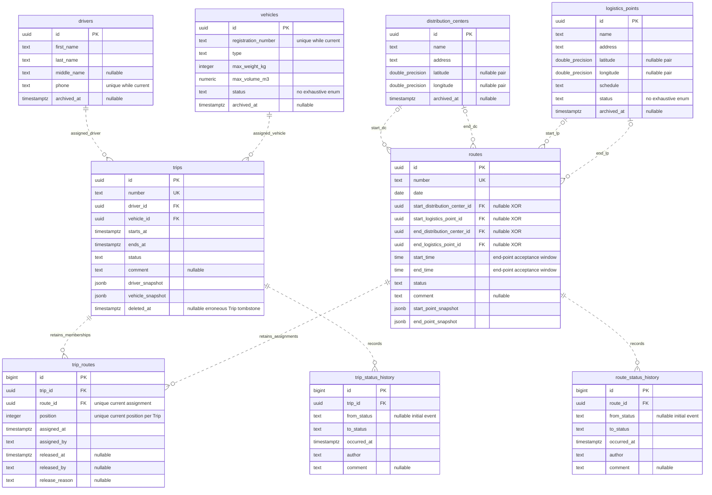

# TMS PostgreSQL schema

## Constraints

- Columns are `NOT NULL` unless marked nullable. All FKs reference the parent's
  `id` with `ON DELETE RESTRICT`; business history is not cascade-deleted.
- UUID PKs default to `gen_random_uuid()`; bigint PKs are generated identities.
  Nullable archive, deletion, release and comment fields default to null.
  Other defaults are listed below; unlisted columns have none.
- Route and Trip numbers are generated independently, immutable and never reused.
  The `MR-` / `TR-` format has no six-digit lifetime limit.
- Required Driver names/phone, Vehicle registration/type/status and point
  names/addresses must be nonblank. Names and addresses are not unique.
- Driver phone and Vehicle registration are unique only where `archived_at IS NULL`.
  This applies to canonical stored values; normalization is not yet approved.
- Coordinates are both null or both present: latitude in [-90, 90], longitude
  in [-180, 180]. Vehicle capacities must be finite; units are integer kg and
  decimal m³. Capacity bounds and volume scale are not yet approved.
- Each Route endpoint has exactly one non-null FK: Distribution Center XOR
  Logistics Point. Start and end points may belong to either directory.
- Route times are minute-precision `time(0) without time zone`, seconds zero,
  hours 00–23: the acceptance/service window at the end point, not travel times.
  No start/end ordering constraint is approved for Route windows.
- Route/Trip statuses and history status values are limited to `created`,
  `assigned`, `intransit`, `completed`. Route status defaults to `created`;
  Trip status defaults to `assigned`. Vehicle/Logistics Point statuses have
  no approved exhaustive enum or default.
- Trip timestamps must be finite with `ends_at > starts_at`. Non-deleted Trips
  must not overlap for the same Driver or Vehicle, including completed Trips.
  The proposed half-open `[starts_at, ends_at)` boundary convention still needs
  approval; a deleted erroneous Trip no longer reserves its interval.
- Snapshot columns in the diagram remain proposals, not approved capture or
  retention policies. Proposed snapshot values are JSON objects, not null or
  arrays. The approved requirement is that Route data used at Trip assignment
  remains historically fixed for that Trip; its field set/storage is unresolved.
- Completed Routes cannot be changed/deleted; completed Trips cannot be changed,
  logically deleted or recomposed. Archive/tombstone eligibility and retention
  policies remain proposals; `deleted_at` is not a domain status.

## Assignments and history

- Route ↔ Trip is N:M over assignment history. A Route has at most one unreleased
  assignment. A non-deleted Trip has at least one; a deleted Trip has none.
- Current assignments have `released_at IS NULL` and are ordered by positive
  `position`. UNIQUE `(route_id)` and `(trip_id, position)` apply only to current
  rows. Positions need not be contiguous; `(trip_id, route_id)` is not globally
  unique because a Route may leave and later return to the same Trip.
- Completion leaves membership unreleased, preserving the completed composition.
  Detach closes a row; transfer closes it and adds another. Closed rows are
  retained unchanged; reordering is not a full reorder audit.
- `assigned_at` defaults to `clock_timestamp()`. Release timestamp/actor/reason
  are all null or all present, and `released_at >= assigned_at` when present.
- Successful Trip creation assigns its selected unassigned `created` Routes and
  the Trip to `assigned`. Transfer sets assignment status to `assigned`; release
  of a not-yet-started Route restores `created`. Unapproved in-progress release
  or transfer cases are rejected; completed Routes cannot be moved.
- Status histories are append-only server facts; `from_status IS NULL` marks an
  initial event, and `occurred_at` defaults to `clock_timestamp()`. Route status
  changes do not automatically derive Trip status.
- `author`, `assigned_by`, `released_by` are server-resolved display labels,
  not client-supplied identities or authentication FKs. No permanent
  Driver ↔ Vehicle relationship exists.
